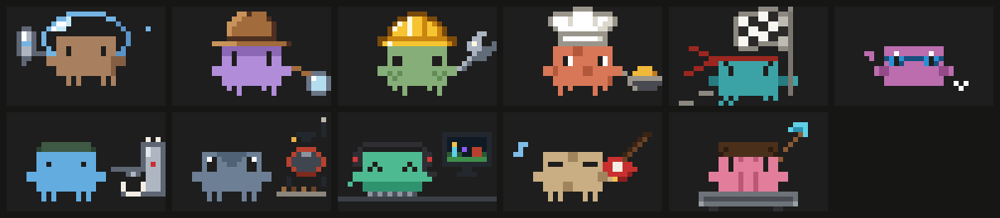
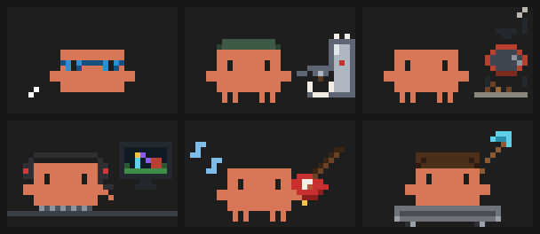

# claude-plugins

Diego Carrillo's Claude Code plugins: mods that change Claude Code's own interface, and design systems packaged as skills.



| Plugin | What it does |
| --- | --- |
| [crab-crew](plugins/crab-crew) | Mod: a progress bar above the prompt and a `/agents-info` panel where every subagent is its own animated pixel-art Clawd crab, in eleven costumes. An extension of [savvy-progress](https://github.com/JohnnyVizz/claude-kit/tree/main/plugins/savvy-progress) by JohnnyVizz |
| [crab-crew-design-system](plugins/crab-crew-design-system) | Design system skill: the Crab Crew brand book, tokens, crab kit and React components, used by Claude whenever you build UI in that style |

## The Clawds

crab-crew has eleven costumes: the five classics from savvy-progress, redrawn as pixel art, and six new ones.



- **Swimmer**: swims laps and pushes its goggles up at each turn
- **Barista**: pulls an espresso
- **Coffee roaster**: tends a little drum roaster
- **Gamer**: plays a fantasy MMO at the PC
- **Guitarist**: electric guitar and pick
- **Miner**: rides a minecart along the rails

Every crab also gets its own colour, eyes, markings and name, so no two on screen look alike. All costumes, poses and what's new compared with savvy-progress are in the [crab-crew README](plugins/crab-crew); the style behind them is the [Crab Crew design system](plugins/crab-crew-design-system).

## Credits

crab-crew is an extension of [savvy-progress](https://github.com/JohnnyVizz/claude-kit/tree/main/plugins/savvy-progress) from [JohnnyVizz/claude-kit](https://github.com/JohnnyVizz/claude-kit). I loved the idea of watching subagents as crabs and wanted more Clawds, so crab-crew builds on it with a crab of its own for every subagent, more costumes and a pixel-art desktop panel.

## Install

In a Claude Code terminal session:

```
/plugin install crab-crew --marketplace DiegoCarrillo32/claude-plugins
/plugin install crab-crew-design-system --marketplace DiegoCarrillo32/claude-plugins
```

Answer `y` to add the marketplace, then pick a scope (user scope makes it available in every session).

Or from your shell:

```bash
claude plugin marketplace add DiegoCarrillo32/claude-plugins
claude plugin install crab-crew@diego-plugins --scope user
claude plugin install crab-crew-design-system@diego-plugins --scope user
```

A plugin installed at user scope also loads in the Claude desktop app's Code tab.

## Adding a plugin

Put it in `plugins/<name>/` with its own `.claude-plugin/plugin.json`, then list it in `.claude-plugin/marketplace.json`. A plugin that lives in another repository can be listed with a GitHub source instead of a path.

## License

[MIT](LICENSE) © 2026 Diego Carrillo. Clawd belongs to Anthropic; see [NOTICE](NOTICE) for credits and trademarks.
