# Crab Crew

A Claude Code mod that turns your subagents into a crew of pixel-art crabs. Every crab is Claude Code's own crab, Clawd, with a look of its own: its own colour, eyes, markings, name and costume, and it walks, swims, roasts or rocks while its subagent works.


Crab Crew is an extension of [savvy-progress](https://github.com/JohnnyVizz/claude-kit/tree/main/plugins/savvy-progress) by [JohnnyVizz](https://github.com/JohnnyVizz). The idea of a progress bar above the prompt and a panel of subagents as crabs comes from there. I liked the project and wanted more Clawds, so Crab Crew builds on it; see [what's different](#whats-different-from-savvy-progress).

## What you get

**Progress bar above the prompt.** Clawd, the flow's title and phase, a slim pixel bar of accepted tasks out of planned (one notch per task), and a **Crew** button that opens the panel. It appears whenever there is something to follow: a flow reporting progress (a workflow, the task list, or the `report_progress` tool), or subagents running or planned, so you can follow along without opening the panel.

**`/agents-info` panel.** Running, planned and finished subagents. Each running crab gets a card in its own colour: the crab at work in its lane, its name and costume, the task, what it is doing right now ("Reading session.ts"), model, effort, task progress, context used, estimated cost, elapsed time and time left. Planned crabs doze until they start and then wake up as themselves; finished crabs celebrate; stopped ones get crossed-out eyes. `/agents-info reset` clears the flow and the finished crabs.

## The Clawds

### Five classic costumes

The five tiers savvy-progress introduced, redrawn as pixel art on Clawd's exact banner proportions.

| | Costume | Animation |
| --- | --- | --- |
| 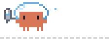 | Astronaut | floats in a glass helmet, an air tank puffing |
| 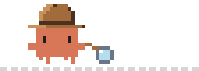 | Detective | sweeps a magnifying glass along the ground |
| 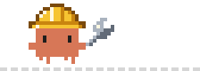 | Engineer | turns a wrench in a hard hat |
| 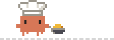 | Chef | tosses and flips an omelette |
| 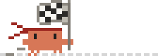 | Racer | runs with a fluttering checkered flag |

### Six new Clawds

New in Crab Crew.


| | Costume | Animation |
| --- | --- | --- |
| 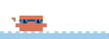 | Swimmer | swims laps across the water and pushes its goggles up at every turn |
| 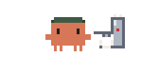 | Barista | pulls an espresso: the shot runs, crema forms, steam curls up |
| 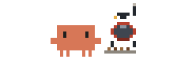 | Coffee roaster | tends a little drum roaster while beans drop into the tray and smoke rises |
| 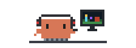 | Gamer | sits at the PC in a headset, playing a fantasy MMO on screen |
| 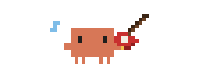 | Guitarist | strums an electric guitar with a pick, notes floating off |
| 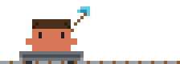 | Miner | a blocky miner with a diamond pickaxe, riding a minecart along the rails |

### Poses

| 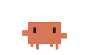 | 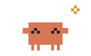 | 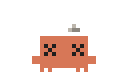 | 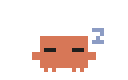 |
| --- | --- | --- | --- |
| working | done | stopped | planned, dozing |

### Every crab is its own

Each subagent gets a look that no other crab on screen has: one of 16 colours, 10 eye styles and 11 markings, a costume, and one of 80 names ("Barnacle the engineer"). A planned crab keeps its look when it starts.

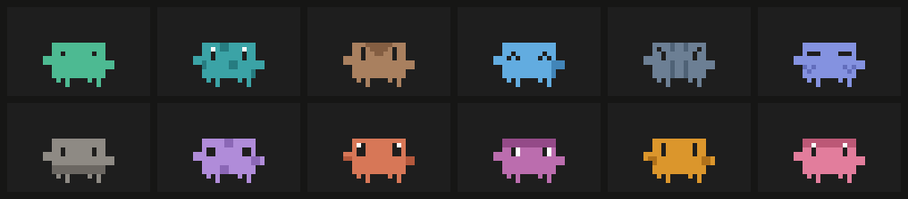

## What's different from savvy-progress

| | savvy-progress | Crab Crew |
| --- | --- | --- |
| Costumes | 5, one per savvy tier | 11: the five classics redrawn plus swimmer, barista, coffee roaster, gamer, guitarist and miner |
| Crab identity | by tier | every crab unique: 16 colours × 10 eyes × 11 markings, 80 names |
| Art | animated crabs | pixel art on Clawd's exact banner grid; animated SVG on desktop, banner-style block glyphs in the terminal |
| Lanes | working crabs walk | walking, swimming (water, goggles up at each turn), rolling on rails, floating, or at a desk or machine |
| Progress bar | appears when savvy-flow reports | also appears whenever subagents are running or planned |
| Design system | none | the [Crab Crew design system](../crab-crew-design-system): tokens, crab kit, sprites and React components to build more crab UIs |

## Design system

The look of Crab Crew is written down as the [Crab Crew design system](../crab-crew-design-system), a separate skill plugin: colour and type tokens for Day and Night themes, the crab kit, every sprite as text grids, and React components (crew cards, pixel bars, crab piles, speech bubbles and more). Install it to have Claude build other interfaces in the same style.

| 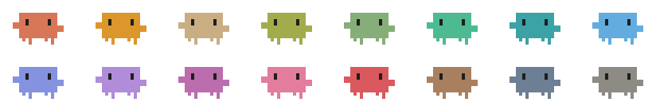 | 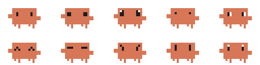 | 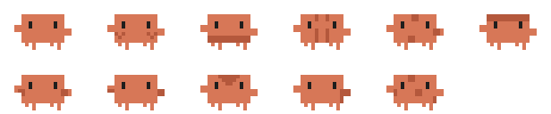 |
| --- | --- | --- |
| 16 colours | 10 eye styles | 11 markings |

## Setting

**Crab costumes** (`costume`): `crew` (default) gives every crab a different costume, drawn from all eleven; `effort` makes the costume follow the agent's effort level (max astronaut, xhigh detective, high engineer, medium chef, low racer). Change it with `/plugin configure crab-crew@diego-plugins`.

## Notes

- Cost is an estimate from Anthropic's first-party API prices.
- The `report_progress` tool is always in Claude's tool list so it can report flows, which adds a few tokens per request.

## Credits

Based on [savvy-progress](https://github.com/JohnnyVizz/claude-kit/tree/main/plugins/savvy-progress) by JohnnyVizz (MIT). Clawd is Claude Code's own crab, drawn from its welcome banner.

## Development

```bash
claude plugin validate plugins/crab-crew
claude plugin test plugins/crab-crew
```
